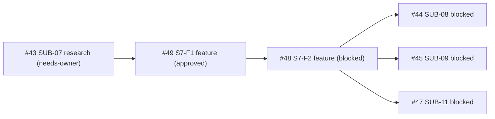

# SUB-07 正式实现拆分 — DAG 修订（S7-F1 / S7-F2）

**Decision ID**: `ISSUE-PILOT-SUB07-F1-F2-SPLIT-V1`
**Parent**: #36 · **Research ancestor**: #43（SUB-07，保持 `type:research`）
**Date**: 2026-11-03
**合同**: `sub07_formal_implementation_contract.md` @ c290e0e（冻结 8 项）

## 1. 拆分结果

Owner 批准将 #43 正式实现拆为两个独立 Feature Sub-Issue：

| Issue | 任务 | 类型 | 状态 | 依赖 |
|---|---|---|---|---|
| **#49** | S7-F1：THREAD_SPAWN 事实生产正式化 | `type:feature` | `approved` / `need:author` | #43 研究合同 |
| **#48** | S7-F2：受限 DEREF_RESOLVES_TO 消费 + FIX-05 闭环 | `type:feature` | `blocked` / `need:owner` | **#49 verified/closed（硬前置）** |

- #43 保持 `type:research / status:needs-owner / need:owner`，作为研究祖先，**不改为 feature-approved**。
- S7-F1 / S7-F2 分别提交、独立 Review，不允许跨阶段偷跑（F1 未 merge 不得启动 F2 生产实现）。

## 2. 依赖边（更新）

```text
FOUNDATION_VERIFIED = {#37, #38, #40, #41, #42}   #39 closed/verified

#43 (SUB-07 research, type:research)  -- 研究祖先，保持 needs-owner
  └─> #49 (S7-F1, feature, approved)  <- sub07_formal_implementation_contract.md @ c290e0e
        └─> #48 (S7-F2, feature, blocked)  <- #49 verified/closed（硬前置）

#44 <- #48（SUB-07 正式可消费输出）+ THREAD_JOIN handle 事实 + 独立 Owner approval
#45 <- #48（fp/identity 能力）+ call relation contract 冻结 + 独立近似分析 Owner approval
#46 <- #39 verified 稳定 surface
#47 <- #41 + #48（#43 正式输出）+ #44 verified + #45 verified
```

## 3. DAG



## 4. 不变项

- #44 / #45 / #47 保持 `blocked`，不随拆分自动解锁。
- 合并门沿用合同 §3（真实语料 FP/FN、性能实测、开关回退、全量 CI、独立 Reviewer、旧 envelope
  默认行为不变）。
- 默认关闭，不允许生产合并自动放行。